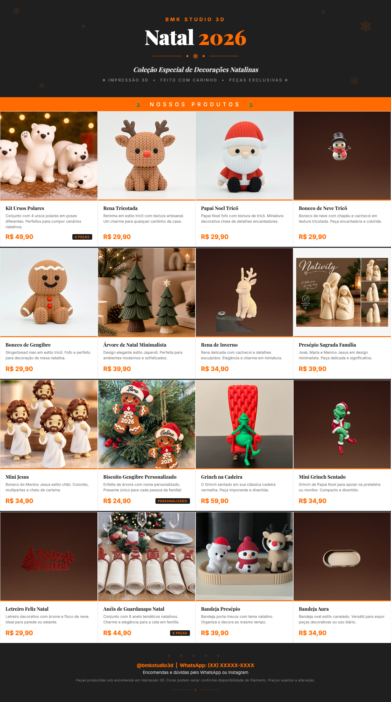

<p align="center">
  
</p>

<h1 align="center">Catálogo de Natal 2026</h1>

<p align="center">
  <strong>BMK Studio 3D</strong> — Peças decorativas em impressão 3D para o Natal 2026
</p>

<p align="center">
  <a href="https://bmkstudio3d.github.io/catalogo-natal-2026/">
    
  </a>
  <a href="https://wa.me/5516999930854">
    
  </a>
  <a href="https://www.instagram.com/bmkstudio3d">
    
  </a>
</p>

---

## Sobre

Catálogo digital interativo da coleção de Natal 2026 da **BMK Studio 3D**, com peças decorativas produzidas em impressão 3D. O catálogo foi desenvolvido como uma página única responsiva, pensada para funcionar perfeitamente em dispositivos móveis e ser compartilhada via WhatsApp.

## Funcionalidades

- **Navegação por slides** — 4 páginas com swipe horizontal (capa, duas páginas de produtos e página do lojista)
- **Cards interativos** — Clique em qualquer produto para ver detalhes em popup com descrição completa
- **Carrinho de compras** — Botão flutuante com controle de quantidade em cada produto
- **Descontos progressivos** — 20% na compra de 3 peças e 30% na compra de 5 ou mais
- **Monte seu Kit Natal** — Bandeja + 2 peças com 20% de desconto, com imagem de sugestão de montagem
- **Integração WhatsApp** — Pedido formatado enviado diretamente para o WhatsApp da loja
- **Compartilhamento** — Envie qualquer produto para um amigo via WhatsApp com link do catálogo
- **Efeitos e animações** — Toasts de milestone, confetti ao atingir faixas de desconto, ticker de promoções
- **100% responsivo** — Otimizado para mobile-first

## Produtos da Coleção

| Código | Produto | Preço |
|--------|---------|-------|
| 0415 | Porta Guardanapo Natalino (6 un.) | R$ 14,90 |
| 2005 | Mini Jesus | R$ 10,90 |
| 3225 | Papai Noel Tricô | R$ 12,90 |
| 3625 | Presépio Sagrada Família | R$ 15,90 |
| 3639 | Biscoito de Gengibre Personalizado | R$ 15,90 |
| 4230 | Boneco de Gengibre Tricô | R$ 8,90 |
| 4684 | Letreiro Feliz Natal | R$ 15,90 |
| 6140 | Árvore de Natal | R$ 18,90 |
| 6297 | Grinch na Cadeira Vermelha | R$ 25,90 |
| 6749 | Urso Polar (individual / Kit 4: R$ 39,90) | R$ 11,90 |
| 6757 | Boneco de Neve Tricô (Em Breve) | R$ 23,90 |
| 3680 | Bandeja Elegante | R$ 12,90 |
| 7382 | Rena de Inverno com Cachecol | R$ 18,90 |
| 7396 | Grinch Sentado | R$ 18,90 |
| 8949 | Rena de Natal Pequena Tricô | R$ 11,90 |
| 0395 | Urso Polar de Natal Tricô (Em Breve) | R$ 10,90 |
| 4520 | Boneco de Neve Tricô Inverno (Em Breve) | R$ 10,90 |

## Descontos

| Condição | Desconto |
|----------|----------|
| Kit Natal (Bandeja Elegante + 2 peças) | **20% OFF** no kit |
| Compra de 3 peças avulsas | **20% OFF** nos avulsos |
| Compra de 5+ peças avulsas | **30% OFF** nos avulsos |

> Os descontos de kit e de quantidade são independentes e acumuláveis no mesmo pedido.

## Tecnologia

Projeto desenvolvido como **single-page HTML** — sem frameworks, sem dependências externas, sem build. Apenas HTML, CSS e JavaScript vanilla em um único arquivo.

- CSS Grid e Flexbox para layout responsivo
- CSS Custom Properties para tema consistente
- JavaScript vanilla para carrinho, kit builder e interações
- Animações CSS com `@keyframes` e `IntersectionObserver`
- WhatsApp deep links para pedidos e compartilhamento

## Como usar

Acesse o catálogo online: **[bmkstudio3d.github.io/catalogo-natal-2026](https://bmkstudio3d.github.io/catalogo-natal-2026/)**

Ou clone e abra localmente:

```bash
git clone https://github.com/bmkstudio3d/catalogo-natal-2026.git
cd catalogo-natal-2026
open index.html
```

---

<p align="center">
  Feito com impressão 3D por <strong>BMK Studio 3D</strong> — Araraquara/SP
</p>
